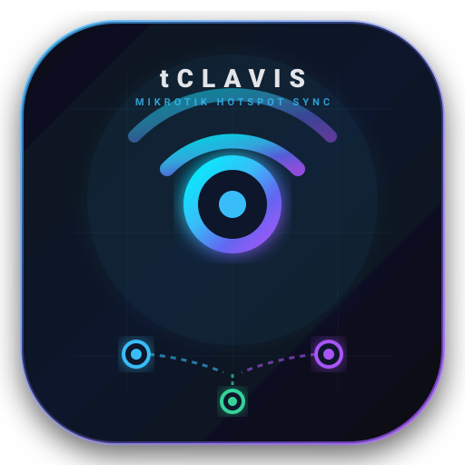

# 🔑 tClavis

<p align="center">
  
</p>

<p align="center">
  <strong>Gestor Centralizado & Sincronizador Inteligente de Hotspot MikroTik</strong><br />
  <em>Gerencie múltiplos roteadores MikroTik simultaneamente com sincronização de usuários, senhas e perfis.</em>
</p>

---

## 🎯 Sobre o Projeto

O **tClavis** é um aplicativo desktop projetado para simplificar a administração de redes com múltiplos roteadores **MikroTik RouterOS**, eliminando a necessidade de servidores RADIUS complexos para ambientes que necessitam de autenticação hotspot compartilhada.

### Principais Diferenciais:
* 🔄 **Sincronização Multi-MikroTik:** Criação, edição e exclusão de usuários e senhas refletidas simultaneamente em todos os roteadores do cluster.
* 🔗 **Mapeamento de Servidores Hotspot (Server Linking):** Conecta instâncias de Hotspot com nomes diferentes em caixas distintas sob um mesmo domínio lógico.
* 🔀 **Mapeamento De-Para de Grupos (Profiles):** Traduz um grupo global (ex: *Visitantes*) para os perfis específicos de cada roteador (ex: *Perfil_10M* na Sede, *Guest_Eventos* na Filial).
* ⚡ **Fila de Sincronização Resiliente:** Operações em roteadores temporariamente inalcançáveis entram em fila e são reprocessadas automaticamente quando a conexão é restabelecida.
* 📡 **Monitor de Sessões Ativas:** Visualização unificada de `/ip hotspot active` com opção de desconectar (*kick*) usuários em tempo real.
* 🖨️ **Gerador de Vouchers & QR Code:** Emissão em lote de acessos temporários formatados para impressoras térmicas (58mm/80mm) ou folhas A4 com QR Code para login rápido.
* 🛡️ **IP & MAC Binding (Bypass):** Liberação de dispositivos sem navegador (Smart TVs, impressoras de rede) replicada em todos os roteadores.

---

## 🛠️ Stack Tecnológica

* **Desktop Runtime:** Electron (Node.js + Chromium)
* **Frontend:** React, TypeScript, Vite, Tailwind CSS, Lucide Icons
* **Banco Local:** SQLite (`better-sqlite3` / Drizzle ORM) com criptografia AES-256 para credenciais
* **Comunicação de Rede:** RouterOS API nativa (TCP 8728 / SSL 8729) e REST API (v7)

---

## 🚀 Estrutura do Repositório

```
tClavis/
├── .gitignore          # Regras de exclusão (ignora arquivos locais/privados, builds e caches)
├── README.md           # Apresentação do projeto
├── tclavis-icon.svg    # Ícone oficial em vetor SVG
└── src/                # Código-fonte (Main Process, Preload e Renderer)
```

---

## 📄 Licença

Propriedade privada. Todos os direitos reservados.
