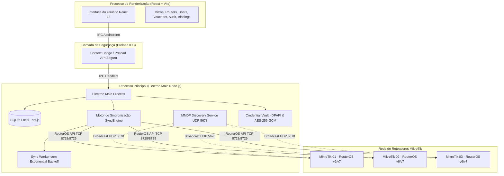

# 01. Conceitos & Arquitetura

Nesta página você compreenderá como o **tClavis** foi concebido, quais problemas ele resolve e como funcionam os principais pilares de sua arquitetura lógica e técnica.

---

## 🎯 O Desafio do Ambiente Multi-MikroTik

Em redes empresariais, provedores de internet, pousadas, escolas ou condomínios, é muito comum ter múltiplos roteadores MikroTik instalados para cobrir diferentes áreas ou blocos:

```
[ MikroTik 01 - Recepção / Bloco A ]
[ MikroTik 02 - Restaurante / Bloco B ]
[ MikroTik 03 - Área Externa / Piscina ]
```

Ao utilizar o **MikroTik Hotspot** nativo, cada roteador possui sua própria tabela local de usuários (`/ip hotspot user`). Isso cria um grande problema operacional:
* Um usuário criado na Recepção não consegue autenticar no Restaurante a menos que alguém cadastre manualmente os mesmos dados no segundo roteador.
* Se você alterar a senha de um cliente ou desativá-lo, precisará acessar todas as caixas via Winbox e repetir a alteração uma a uma.
* A alternativa tradicional é implantar um servidor **RADIUS** externo (como FreeRADIUS ou User Manager). No entanto, o RADIUS exige um servidor físico ou máquina virtual dedicada 24/7, configuração avançada de túneis/chaves secretas, e se o servidor cair, toda a autenticação da rede é interrompida.

---

## 💡 A Solução tClavis: Cluster Local Descentralizado

O **tClavis** adota uma abordagem moderna e descentralizada:
1. **O tClavis atua como Maestro:** Você gerencia toda a sua rede a partir de uma interface amigável e centralizada.
2. **Cada MikroTik mantém seus usuários locais:** O tClavis escreve diretamente na base de usuários de cada MikroTik (`/ip hotspot user`).
3. **Autonomia Total do Roteador:** Se o computador onde o tClavis está instalado for desligado, os clientes continuam navegando e autenticando normalmente, pois os usuários já estão gravados nas memórias dos MikroTiks!
4. **Replicação Instantânea:** Ao criar ou editar um voucher no tClavis, a alteração é replicada em paralelo em todas as caixas cadastradas.

---

## 🧩 Conceitos Fundamentais

### 1. Roteador Físico (`RouterDevice`)
Representa cada caixa MikroTik física na rede, configurada com seu endereço IP (ou hostname), porta de API (padrão `8728` ou `8729` com SSL), usuário e senha de acesso.

### 2. Grupo Lógico (`LogicalGroup`)
Em vez de vincular um usuário diretamente a um perfil técnico de roteador, o tClavis utiliza o conceito de **Grupo Lógico**.
* Exemplo de Grupos Lógicos: `Visitantes`, `Colaboradores`, `Diretoria`, `Vouchers 2 Horas`.
* Cada Grupo Lógico possui uma regra **De-Para**: ele sabe qual **Profile** do MikroTik deve ser aplicado em cada roteador específico.

### 3. Mapeamento "De-Para"
Permite que ambientes com roteadores heterogêneos coexistam pacificamente:
* No **Roteador 01 (Sede)**, o grupo *Visitantes* pode corresponder ao perfil `perfil_visitante_10mb`.
* No **Roteador 02 (Filial)**, o mesmo grupo *Visitantes* pode apontar para `guest_5mb` (devido a um link de internet menor).
* O operador não precisa lembrar qual perfil pertence a qual caixa: ele simplesmente seleciona *Visitantes*, e o tClavis traduz o perfil correto para cada MikroTik.

### 4. Servidor Lógico (`LogicalServer`)
No MikroTik Hotspot, um usuário pode ser restrito a uma interface/instância de servidor específica (`server=all` ou `server=hotspot1`). O tClavis permite criar um Servidor Lógico que mapeia o nome correto da instância em cada roteador.

### 5. Fila de Sincronização (`SyncQueue`) com Retry Resiliente
Se um roteador estiver desligado, em manutenção ou passar por oscilação de cabo de rede no momento em que você criar um usuário:
* O tClavis não perde a operação.
* A tarefa é gravada em uma fila local persistente (`SyncQueueItem`).
* O **Sync Worker** em segundo plano testa a conectividade periodicamente e, assim que o roteador retorna à rede, sincroniza todas as pendências automaticamente com algoritmo de *Exponential Backoff*.

---

## 🏗️ Arquitetura Técnica



### Tecnologias Utilizadas
* **Electron 34:** Isolamento de contexto estrito (`contextIsolation: true`, `nodeIntegration: false`).
* **React 18 + TypeScript 5:** Tipagem estrita de todos os modelos de dados e interface fluida e moderna.
* **Tailwind CSS:** Interface otimizada com tema escuro nativo (*Dark Mode*).
* **sql.js (SQLite):** Banco de dados relacional embarcado gravado diretamente no diretório do usuário do sistema operacional, sem dependência de DLLs externas ou serviços instalados no Windows.
* **Protocolo de Rede Nativo:** Cliente binário da API RouterOS (portas `8728` e `8729`) e suporte alternativo à REST API do RouterOS v7.
