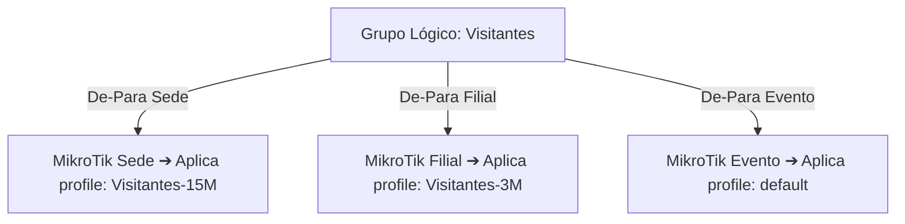

# 04. Mapeamento Lógico (De-Para)

O motor de **Mapeamento De-Para** é uma das inovações mais poderosas do tClavis. Ele desacopla a complexidade técnica dos roteadores MikroTik da rotina operacional de criação de acessos.

---

## 🎯 Por que o Mapeamento Lógico é Necessário?

Em um cluster de múltiplos roteadores MikroTik, é quase impossível que todos tenham exatamente as mesmas configurações:
* O **Roteador da Sede** pode ter uma conexão de fibra de 1 Gbps e ter configurado o perfil `/ip hotspot user profile` chamado `Visitantes-15M`.
* O **Roteador da Filial** pode ter um link 4G ou via rádio limitado a 50 Mbps e ter criado o perfil chamado `Visitantes-3M`.
* O **Roteador do Evento** pode usar o perfil padrão `default`.

Sem o tClavis, a recepção ou o atendente precisaria saber qual é o nome técnico do perfil de cada caixa. 

Com o **tClavis**, você cria um **Grupo Lógico** unificado (por exemplo, `Visitantes`) e ensina ao sistema qual perfil deve ser aplicado em cada roteador:

---

## 🛠️ Como Configurar Grupos Lógicos

1. Acesse o menu **Mapeamento** no tClavis.
2. Na aba **Grupos Lógicos**, clique em **Novo Grupo Lógico**.
3. Preencha:
   * **Nome do Grupo:** Ex: `Hóspedes`, `Colaboradores`, `VIP`, `Vouchers 24h`.
   * **Descrição:** Breve resumo sobre quem usa esse grupo.
   * **Rate Limit (Opcional):** Ex: `10M/10M` (Rx/Tx).
4. Na seção **Associação por Roteador**, você verá uma linha para cada MikroTik cadastrado.
5. Selecione no menu suspenso o **Profile** correspondente em cada equipamento.
   * *(O tClavis lista em tempo real todos os perfis detectados na caixa).*
6. Clique em **Salvar Grupo**.

---

## 🪄 Criação Remota de Perfis Faltantes

Se você estiver configurando uma nova caixa MikroTik e perceber que ela ainda não tem o perfil desejado criado, você não precisa abrir o Winbox!

Ao editar o mapeamento no tClavis:
1. Digite o nome do novo perfil desejado.
2. O tClavis identifica que o perfil não existe naquele MikroTik e exibe o botão **Criar Perfil no MikroTik**.
3. Ao clicar, o tClavis envia uma chamada de API diretamente para a caixa via `/ip hotspot user profile add` e cadastra o perfil imediatamente.

---

## 🌐 Servidores Lógicos (Hotspot Servers)

Além dos perfis de velocidade, o MikroTik permite vincular o usuário a um servidor de Hotspot específico (`server`):
* `all`: O usuário pode logar em qualquer interface ou servidor hotspot daquela caixa.
* `hotspot1`, `hs_piscina`, `hs_interno`: O usuário só pode autenticar na interface correspondente àquela instância.

Na aba **Servidores Lógicos** da tela de Mapeamento, você pode criar regras globais similares:
* Exemplo: Servidor Lógico `Wi-Fi Público` -> aponta para `hs_publico` no Roteador 1 e para `hotspot-visitante` no Roteador 2.
* Para a maioria das redes convencionais, o valor padrão `all` é o mais recomendado, permitindo trânsito livre do cliente entre as antenas.
