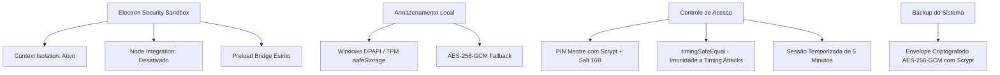

# 11. Segurança, Criptografia & Backups

O **tClavis** foi desenvolvido com um modelo de segurança em camadas (*defense-in-depth*), garantindo que credenciais de infraestrutura crítica fiquem protegidas contra vazamentos, espionagem local e ataques cibernéticos.

---

## 🛡️ Camadas de Segurança do Aplicativo



---

## 🔐 Cofre de Credenciais (CredentialVault)

As senhas dos seus roteadores MikroTik nunca são armazenadas em texto simples no disco:

1. **Proteção Nativa no Windows (DPAPI + TPM):**
   * O tClavis utiliza o módulo `safeStorage` do Electron, que se conecta diretamente à **Data Protection API (DPAPI)** do Windows.
   * As chaves de decodificação ficam atreladas ao perfil de usuário do sistema operacional e, caso disponível, protegidas pelo chip **TPM (Trusted Platform Module)** da placa-mãe.
2. **Fallback Criptográfico com AES-256-GCM:**
   * Caso o `safeStorage` não esteja disponível, o tClavis ativa um fallback com cifra simétrica **AES-256-GCM** autenticada com vetor de inicialização (IV) de 96 bits e chave derivada da máquina.

---

## 🔢 O PIN Mestre & Imunidade a Timing Attacks

Para impedir que curiosos no mesmo computador visualizem senhas ou alterem usuários:

* O PIN numérico (4 a 8 dígitos) passa por derivação de chave **Scrypt** com um **Salt criptográfico de 16 bytes** gerado aleatoriamente no primeiro uso.
* A checagem do PIN é realizada por meio da função nativa `crypto.timingSafeEqual`:
  ```typescript
  // Trecho real do código tClavis
  crypto.timingSafeEqual(bufA, bufB);
  ```
  Isso garante que o tempo de resposta da verificação seja exatamente o mesmo independentemente de quantos dígitos estejam corretos, eliminando ataques de análise de tempo (*side-channel timing attacks*).

---

## ⏱️ Sessão Temporizada de 5 Minutos

Após digitar o PIN correto:
* O sistema concede uma **janela de autorização de 5 minutos**.
* Durante esse período, o operador pode editar configurações, visualizar senhas mascaradas e criar roteadores sem interrupções.
* Um contador regressivo visual exibe o tempo restante.
* Ao zerar o cronômetro (ou ao clicar no botão **Bloquear** no cabeçalho), todas as senhas voltam imediatamente ao modo mascarado (`••••••••`).

---

## 📦 Backup & Restauração com Criptografia

Você pode criar cópias de segurança de todo o seu ambiente para migrar de computador ou guardar um ponto de restauração seguro:

### Exportando um Backup
1. Acesse o menu **Configurações** no tClavis.
2. Na seção **Backup & Restauração**, clique em **Exportar Backup**.
3. Uma janela perguntará se você deseja proteger o arquivo com uma **Senha Mestre**.
4. Se você definir uma senha:
   * O tClavis encapsula o banco de dados em um envelope seguro criptografado com **AES-256-GCM** e derivação de chave **Scrypt**.
   * O arquivo `.json` gerado não poderá ser lido por nenhum editor de texto sem a senha correta.

### Restaurando um Backup
1. Na tela de Configurações, clique em **Restaurar Backup**.
2. Selecione o arquivo de backup exportado anteriormente.
3. Se o arquivo estiver protegido, digite a senha informada no momento da criação.
4. O tClavis validará a integridade criptográfica do arquivo antes de aplicar a restauração.
