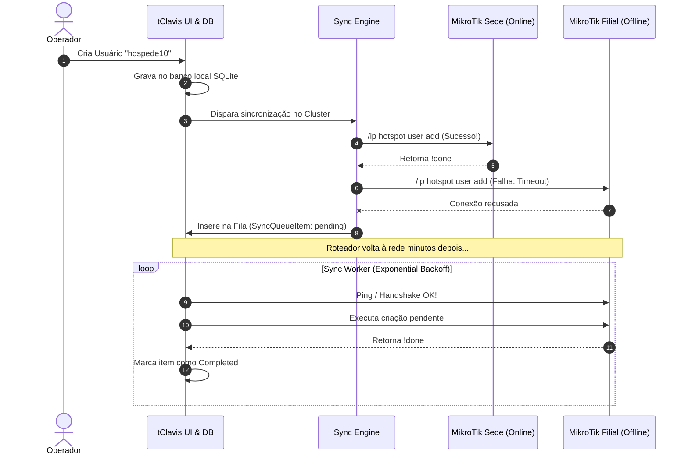

# 12. Fila de Sincronização & Modo Offline

Redes reais sofrem com quedas de energia temporárias, cabos de rede rompidos, manutenções em switches e reinicializações de roteadores. 

O tClavis foi construído com arquitetura de **Tolerância a Falhas e Resiliência Assíncrona**. Uma falha em um roteador nunca interrompe o trabalho do operador.

---

## ⚡ Como Funciona a Fila de Sincronização (Sync Queue)

Sempre que uma operação de escrita é realizada no tClavis (criar usuário, atualizar senha, excluir voucher ou alterar status de bloqueio), o sistema realiza um processamento em duas etapas:

---

## 📈 Algoritmo de Exponential Backoff

Se uma caixa MikroTik estiver fora do ar (por exemplo, desligada durante a noite), tentar reconectar a cada 1 ou 2 segundos geraria sobrecarga inútil de CPU e poluição na rede local.

Para resolver isso, o **Sync Worker** do tClavis implementa o algoritmo de **Exponential Backoff**:

1. **Tentativa 1 com falha:** Aguarda **30 segundos** antes da próxima tentativa.
2. **Tentativa 2 com falha:** Aguarda **60 segundos**.
3. **Tentativa 3 com falha:** Aguarda **120 segundos**.
4. **Tentativas subsequentes:** Atinge o teto seguro de **300 segundos (5 minutos)**.

Assim que a caixa MikroTik responder com sucesso a um teste de conexão, o contador de falhas daquele roteador é **resetado instantaneamente a zero** e todas as ações pendentes na fila são processadas em sequência ordenada.

---

## 📥 Execução em Segundo Plano (Bandeja / Tray)

Para garantir que a fila continue sendo processada mesmo quando você não estiver utilizando a tela do aplicativo:

* Ative a opção **Minimizar para a Bandeja (System Tray)** nas Configurações.
* Ao clicar no "X" para fechar a janela, o tClavis continuará rodando discretamente no relógio do Windows.
* Se um roteador que estava desligado for religado, o tClavis entregará todas as pendências sem que você precise reabrir a janela manualmente.
