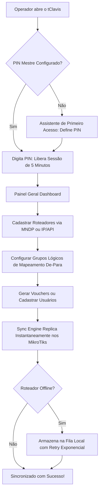

# 🏰 Bem-vindo à Wiki Oficial do tClavis

  

  <strong>Gestor Centralizado & Sincronizador Inteligente de Hotspots MikroTik RouterOS</strong> 
  <em>Administre múltiplos roteadores MikroTik simultaneamente com replicação em tempo real, proteção por PIN mestre, expurgo automático de vouchers e auditoria de paridade.</em>

---

## 📌 O que é o tClavis?

O **tClavis** é uma aplicação desktop de nível corporativo projetada para administradores de rede, provedores de internet (ISPs), hotéis, pousadas, escolas, coworkings e eventos que utilizam mais de um roteador **MikroTik RouterOS** para autenticação de clientes via Hotspot Captive Portal.

Tradicionalmente, gerenciar usuários e vouchers em múltiplos MikroTiks exige:
1. **Cadastro manual repetitivo** em cada roteador via Winbox/WebFig; ou
2. **Implantação complexa e cara de servidores RADIUS** (FreeRADIUS, User Manager), que exigem servidores dedicados, banco de dados externo, manutenção de túneis VPN e conhecimento avançado.

O **tClavis elimina essa barreira**: ele opera como uma camada de orquestração inteligente local. Quando você cria, altera ou remove um usuário ou lote de vouchers, o tClavis replica a operação em **todos os roteadores do cluster instantaneamente**, mantendo tudo sincronizado com tolerância a falhas offline.

---

## 🗺️ Mapa de Documentação da Wiki

A documentação está dividida em módulos práticos para facilitar a consulta:

| Seção | Página | Descrição |
| :--- | :--- | :--- |
| **01** | [**Conceitos & Arquitetura**](01-Conceitos-e-Arquitetura) | Entenda a lógica de Cluster, Grupos Lógicos, Servidores Lógicos e Fila de Sincronização. |
| **02** | [**Instalação & Primeiro Acesso**](02-Instalacao-e-Primeiro-Acesso) | Download do executável, instalador vs portátil, configuração do PIN Mestre e inicialização no Windows. |
| **03** | [**Gerenciamento de Roteadores**](03-Gerenciamento-de-Roteadores) | Cadastro de MikroTiks, descoberta automática MNDP, portas de API e criação de usuário restrito no RouterOS. |
| **04** | [**Mapeamento Lógico (De-Para)**](04-Mapeamento-Logico-De-Para) | Como mapear grupos globais em perfis locais específicos de cada roteador. |
| **05** | [**Gerenciamento de Usuários**](05-Gerenciamento-de-Usuarios-e-Vouchers) | Cadastro manual, edição, mascaramento de senhas, limites de tempo/bytes e importação de usuários do roteador. |
| **06** | [**Gerador de Vouchers em Lote & Impressão**](06-Gerador-de-Vouchers-em-Lote-e-Impressao) | Geração em massa com senhas seguras, QR Code para login rápido e impressão térmica (58mm/80mm) ou A4. |
| **07** | [**Expurgo Inteligente de Vouchers**](07-Expurgo-Inteligente-de-Vouchers) | Limpeza automática de vouchers expirados e não utilizados para liberar memória RAM e Flash no MikroTik. |
| **08** | [**Auditoria de Paridade & Auto-Repair**](08-Auditoria-de-Paridade-e-Auto-Repair) | Comparação automática entre o banco de dados do tClavis e as caixas MikroTik, com reparo em 1 clique. |
| **09** | [**Dispositivos Autorizados (IP & MAC Binding)**](09-Dispositivos-Autorizados-IP-MAC-Binding) | Liberação de Smart TVs, câmeras IP, impressoras e consoles sem tela através de bypass centralizado. |
| **10** | [**Monitor de Sessões Ativas**](10-Monitor-de-Sessoes-Ativas) | Acompanhamento em tempo real de clientes conectados, consumo de tráfego e desconexão remota (*kick*). |
| **11** | [**Segurança, PIN Mestre & Backups**](11-Seguranca-Criptografia-e-Backups) | Proteção por Scrypt, criptografia Windows DPAPI / AES-256-GCM e backup com chave de segurança. |
| **12** | [**Fila de Sincronização & Modo Offline**](12-Fila-de-Sincronizacao-e-Modo-Offline) | Tolerância a falhas, reconexão automática e algoritmo de Exponential Backoff. |
| **13** | [**Atualizações Automáticas**](13-Atualizacoes-e-Ciclo-de-Vida) | Como funciona a atualização automática via GitHub Releases. |
| **14** | [**FAQ & Solução de Problemas**](14-Perguntas-Frequentes-e-Troubleshooting) | Respostas para dúvidas comuns, liberação de portas de firewall e comandos de diagnóstico. |
| **15** | [**Guia de Desenvolvimento & Build**](15-Guia-de-Desenvolvimento-e-Build) | Instruções para programadores que desejam compilar o tClavis do código-fonte. |

---

## ⚡ Fluxo de Trabalho Típico

---

## 💡 Destaques Rápidos

* **100% Local & Sem Nuvem Obrigatória:** Todos os dados ficam salvos em um banco de dados local SQLite protegido por criptografia no próprio computador.
* **Compatibilidade Completa com MikroTik:** Suporta **RouterOS v6** e **RouterOS v7** utilizando o protocolo nativo de API (porta `8728` ou `8729` SSL) e REST API (v7).
* **Segurança Reforçada:** Mascaramento estrito de senhas com sessão autorizada de 5 minutos e proteção contra ataques de temporização (*timing attacks*).
* **Zero Impacto no Desempenho do MikroTik:** O tClavis só envia comandos nos momentos necessários, mantendo as RouterBoards leves e sem consumo desnecessário de CPU.

---

> [!TIP]
> Caso seja a sua primeira vez utilizando o tClavis, comece pelo guia passo a passo em [**Instalação & Primeiro Acesso**](02-Instalacao-e-Primeiro-Acesso) e em seguida [**Gerenciamento de Roteadores**](03-Gerenciamento-de-Roteadores).
